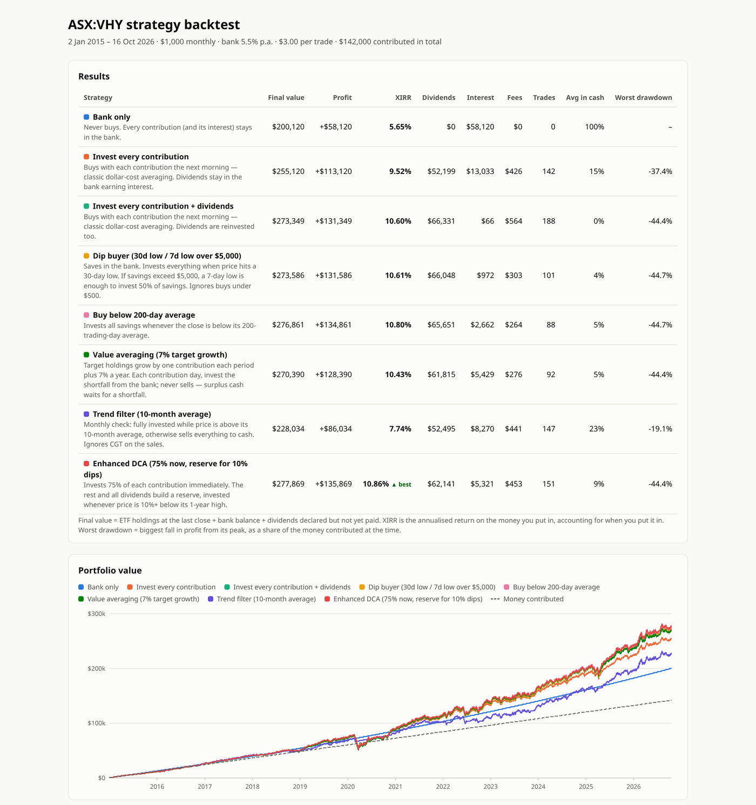
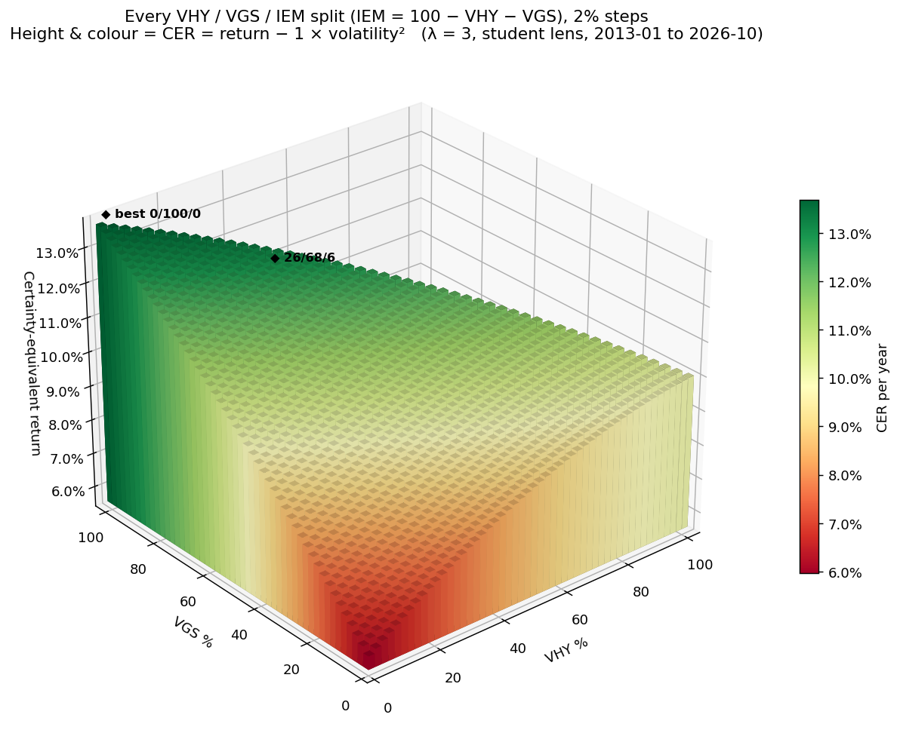

# ETF Backtester

A Python toolkit for testing ETF investing strategies on real ASX price and dividend history, **after Australian
tax**. It simulates a regular investor day by day: contributions landing in a bank account, orders filling at the next
day's open, brokerage, dividends, DRPs, franking credits and capital gains tax. It then asks whether any strategy beats
simply investing every contribution as it arrives, and keeps beating it across many market periods.

The core engine uses only the Python standard library. Built with AI-assisted development in Claude Code.



## What it does

- **Day-by-day simulation, no look-ahead.** A strategy sees prices up to today's close, and its orders fill at the next
  trading day's open, in whole shares, with a brokerage fee. Idle cash earns daily bank interest. Dividends are paid
  after the ex-date, or reinvested through the fund's DRP.
- **Australian tax model.** Marginal rates with LITO and the Medicare levy, refundable franking credits, foreign income,
  and capital gains tax on first-in, first-out parcels. It supports the 50% CGT discount and the CPI-indexed cost base
  that applies from 1 July 2027 (CPI from the ABS data API). Results are reported as after-tax value and XIRR.
- **Market data with repairs.** Daily prices, dividends and splits come from Yahoo Finance and are cached locally. One-day
  price spikes and unadjusted splits are detected and repaired automatically, with a note printed.
- **Pluggable strategies.** Dollar-cost averaging, dip buying, buying below the 200-day average, value averaging, a
  10-month trend filter and an enhanced DCA. A new strategy is a small class with an `on_day` method (see
  [`ETF_Backtester/README.md`](ETF_Backtester/README.md)).
- **Robustness testing.** Every strategy runs on every fund over rolling five-year windows, measured against "invest
  every contribution + dividends" in the same fund and window.
- **Fund comparison.** Eight ASX ETFs (VHY, VAS, A200, IVV, VTS, NDQ, VGS, VEQ), after tax at several income levels.
  Long-running index stand-ins, converted to AUD, extend history back before a fund's launch.
- **Portfolio splits.** Australia / international / emerging-market splits are scored by certainty-equivalent return,
  then by minimax regret across rolling windows: which split holds up whichever market leads next?
- **Self-contained HTML reports** with interactive charts that work offline.



## Quick start

Python 3.10+.

```bash
cd ETF_Backtester
python3 backtest.py                                   # ASX:VHY, $1,000/month from 2015; opens an HTML report
python3 backtest.py --ticker ASX:A200 --start 2018-01-01 --drp
python3 compare.py                                    # 8 ETFs after tax at $20k / $70k / $150k income
python3 robustness.py                                 # every strategy x every fund x rolling 5-year windows
python3 backtest.py --help                            # every option

pip install -r ../requirements.txt                    # only for the split plots below
python3 split_3d.py                                   # 3D map of every three-fund split
python3 robust_split.py                               # minimax-regret split across rolling windows
```

## Repository layout

```
ETF_Backtester/
  engine.py           market data, the day-by-day simulator, XIRR and drawdown metrics
  strategies.py       the strategies (add your own here)
  tax.py              Australian tax: marginal rates, franking, CGT parcels, CPI indexation
  backtest.py         run every strategy on one fund and write an HTML report
  report.py           self-contained HTML report
  compare.py          compare funds after tax at several incomes
  period_check.py     compare funds over chosen periods, with index stand-ins
  robustness.py       rolling-window robustness test
  optimise_split.py   three-fund split search
  split_3d.py         3D maps of every split
  robust_split.py     minimax-regret split selection
etf_timing_compare.py       desktop tool (Tkinter): invest a lump sum now, or wait for a dip?
```

## Notes

- Yahoo Finance has no official API. This uses the public chart endpoint its website uses, so it can change or
  rate-limit without notice. Market data is cached in `ETF_Backtester/data/` and is not committed.
- Franking and foreign-credit ratios per fund are estimates in `tax.py`. Check them against each fund's annual tax
  statement.
- This is a personal research tool, not financial advice. Past returns do not predict future returns.
